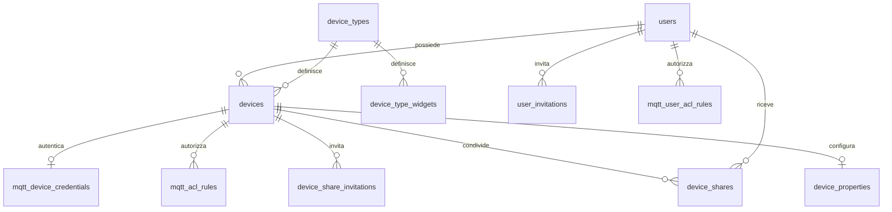

# Database

Il backend usa SQLite e Drizzle. Le tabelle sono oggetti TypeScript; le query ricavano i tipi
in ingresso e in uscita da questi oggetti. L'inizializzazione crea soltanto database nuovi:
non esistono migrazioni o conversioni del vecchio schema.

## Dove intervenire

| File o cartella | Responsabilità |
| --- | --- |
| `backend/src/db/schema/auth.ts` | Utenti e inviti degli amministratori |
| `backend/src/db/schema/devices.ts` | Tipi, firmware, dispositivi, proprietà, widget e condivisioni |
| `backend/src/db/schema/mqtt.ts` | Regole ACL, credenziali cifrate e coda di sincronizzazione broker |
| `backend/src/db/schema/settings.ts` | Impostazioni e proprietà predefinite |
| `backend/src/db/schema/logs.ts` | Storico richieste dei dispositivi |
| `backend/src/repositories/` | Query, proiezioni e salvataggi atomici, divisi per area |
| `backend/src/services/` e `backend/src/utils/` | Regole applicative, cifratura e MQTT |
| `backend/src/controllers/` | Validazione delle richieste, autorizzazioni e risposte HTTP |
| `backend/src/db/dynsecTriggers.ts` | Trigger SQLite che accodano modifiche e cancellazioni per il broker |
| `backend/src/config/database.ts` | Percorso del database e connessione condivisa |
| `backend/src/db/openDatabase.ts` | Creazione atomica dello schema e verifica della sua impronta |
| `backend/src/config/bootstrap.ts` | Creazione esplicita del primo amministratore all'avvio del server |

`backend/src/db/schema.sql` è **generato** dagli oggetti TypeScript: serve per creare il database
anche in produzione, dove Drizzle Kit non è installato. Non modificarlo a mano.
I nomi dei campi già esposti dalle API restano gli stessi, inclusi `deviceProperties`,
`genericProperties` e `mqttTopics`, così web, mobile e firmware mantengono lo stesso contratto.

## Relazioni principali



- I widget conservano il proprio oggetto in `device_type_widgets.definition`; campi, stato e comandi
  sono descritti in [WIDGETS.md](WIDGETS.md). Tutti i dispositivi dello stesso tipo li ereditano senza copie. La revisione su `device_types` protegge i salvataggi concorrenti.
- `devices.name` è l'etichetta umana obbligatoria. `code` è un UUID generato alla creazione;
  l'assegnazione tramite email attiva automaticamente il dispositivo. I nomi non devono essere univoci.
- Ogni dispositivo ha al massimo una riga di proprietà: `device_code` è la chiave primaria.
  `saveDeviceProperties` aggiorna o inserisce questa riga con un UPSERT.
- La cancellazione di un dispositivo rimuove proprietà, condivisioni, inviti e ACL collegati.
  I widget restano associati al tipo; la cancellazione di un tipo inutilizzato rimuove i suoi widget.
- Non si può cancellare un tipo ancora usato o un utente che possiede dispositivi.
- `mqtt_dynsec_queue` non ha un vincolo verso `devices`: deve ricordare anche i dispositivi
  cancellati, finché le loro identità non sono state rimosse dal broker.
- I log conservano il contesto storico anche dopo la cancellazione di utenti o dispositivi.
- Ruoli, azioni ACL, permessi, tipi di proprietà e tipi di widget hanno vincoli derivati
  dalle stesse definizioni condivise usate dall'applicazione. I flag accettano solo `0` e `1`.
- I documenti di proprietà e topic hanno vincoli JSON. Le proprietà dinamiche restano documenti
  JSON perché dipendono dal tipo di dispositivo; la validazione dei loro campi resta applicativa.
- Le letture pubbliche selezionano esplicitamente i campi ammessi. Gli hash delle password,
  i segreti dei dispositivi e il contenuto binario dei firmware non entrano nelle liste del portale.

## Partire da zero

Dalla cartella `backend`, dopo aver configurato le altre variabili d'ambiente:

```sh
npm ci
npm run build
DB_PATH=./data-new.db npx ts-node -r tsconfig-paths/register src/server.ts
```

Usare un percorso non ancora esistente. Il server crea le tabelle, gli indici e i trigger, poi
l'amministratore configurato con `ADMIN_EMAIL` e `ADMIN_PASSWORD`.
Impostare stabilmente lo stesso `DB_PATH` nell'ambiente usato per gli avvii successivi.

Con Docker Compose, dalla radice del progetto, usare una nuova cartella persistente:

```sh
DB_PATH_HOST=./data-new docker compose -f docker-compose.release.yml up -d --build
```

Impostare poi `DB_PATH_HOST=./data-new` nel file `.env` per i comandi successivi.
I dispositivi, le condivisioni, le proprietà e i firmware del vecchio database non vengono importati.
Conservare le chiavi di cifratura configurate se si conservano altri backup o identità MQTT esistenti.
La riconciliazione MQTT continua a rimuovere dal broker le identità dei dispositivi non più presenti.

## Cambiare lo schema

1. Modificare gli oggetti in `src/db/schema/`, riusando le costanti di `shared/`.
2. Aggiornare i repository interessati e gli eventuali chiamanti.
3. Eseguire `npm run build`: rigenera `src/db/schema.sql` e lo include nell'output compilato.
4. Eseguire `npm test`. Le suite usano soltanto database temporanei.
5. Avviare con un nuovo `DB_PATH` quando cambia lo schema o il contenuto dei trigger.

Il database memorizza in `PRAGMA user_version` un'impronta del DDL e dei trigger. All'avvio,
uno schema diverso produce un errore esplicito prima di applicare modifiche al database esistente.
Il normale riavvio con lo stesso schema conserva dati e coda MQTT.

## Scrivere una query

Usare gli oggetti dello schema nel repository appropriato:

```ts
import { eq } from "drizzle-orm";
import { db } from "../config/database";
import { deviceProperties } from "../db/schema";

export function getDeviceProperties(code: string) {
    return db.select().from(deviceProperties)
        .where(eq(deviceProperties.device_code, code)).get();
}
```

Il tipo restituito viene ricavato automaticamente dalla tabella, compresa la possibilità che la
riga non esista. Per un tipo di inserimento usare `typeof deviceProperties.$inferInsert`;
per una riga letta usare `typeof deviceProperties.$inferSelect`.

Riutilizzare le funzioni già presenti per utenti, accesso ai dispositivi, proprietà e topic collegati.
I controller chiamano queste funzioni senza costruire SQL. Le query frequenti e gli inserimenti
nei cicli riutilizzano statement preparati. I salvataggi di più righe usano transazioni sincrone:
le chiamate asincrone al broker rimangono fuori dalle transazioni SQLite.

## Consultare i dati

```sh
cd backend
DB_PATH=./data-new.db npm run db:studio
```

Drizzle Studio consente di consultare tabelle e relazioni da un'interfaccia grafica.
Gli aggiornamenti diretti saltano le validazioni applicative e la cifratura: usare le API per
modificare credenziali, proprietà sensibili, inviti e autorizzazioni. I vincoli SQLite e i trigger
restano attivi anche per le scritture dirette.

`DB` in `config/database.ts` espone la connessione nativa per diagnostica e fixture dei test;
il codice applicativo usa `db` tramite i repository.
